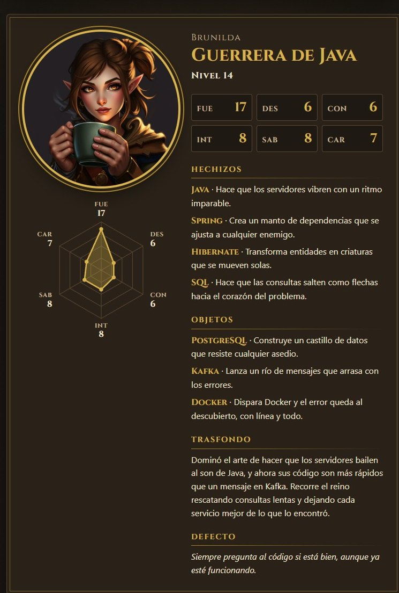
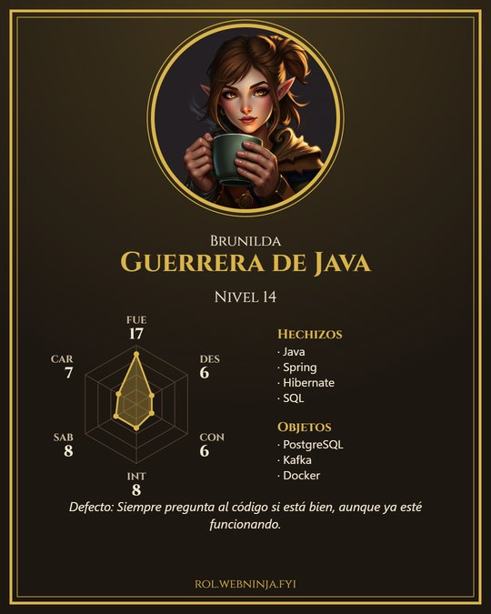
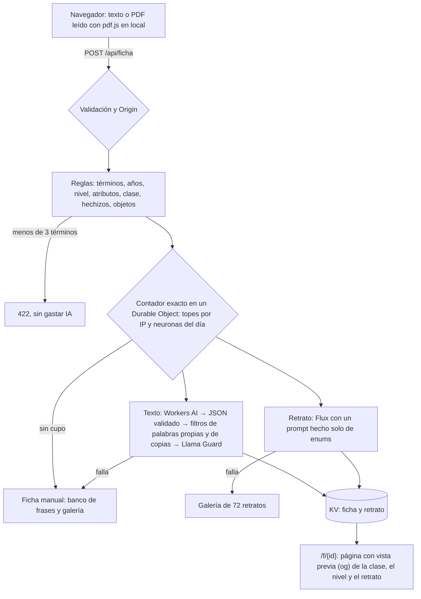

# Ficha de Rol

[](https://github.com/Ogires/ficha-de-rol/actions/workflows/ci.yml)

> *Tu CV ya era una ficha de personaje. Solo faltaba tirar los dados.*

Pegas tu CV (o el «Acerca de» de LinkedIn, o eliges un PDF) y recibes una ficha de juego de rol: clase, nivel, seis atributos en un hexágono, hechizos, objetos, trasfondo, defecto y un retrato pintado por IA. La ficha se descarga como imagen vertical para el feed y tiene un enlace permanente con vista previa. Coste de producción: 0 €.

**▶ Tira iniciativa en <https://rol.webninja.fyi>**

<p align="center">
  
  
</p>
<p align="center"><sub>Ficha generada a partir de un CV inventado.</sub></p>

## Cómo funciona

Las **reglas** calculan todo lo que tiene números: son deterministas, explicables («¿por qué tengo FUE 17?») y se pueden testear. La **IA** solo pone la narrativa y el retrato.



### Nivel y atributos

- **Nivel** = años de experiencia, de 1 a 20. Salen de los rangos de fechas del CV (sin contar la formación) o de la frase «N años de experiencia».
- **Atributos**: cada término del catálogo (unos 220, en [`data/catalogo.json`](data/catalogo.json)) suma a un atributo, con un máximo de 3 menciones por término. El más fuerte llega a `10 + ⌊nivel / 2⌋` y los demás, en proporción. Uno sin términos se queda en 6 y su «¿por qué?» lo explica.

| Atributo | Suben con | Clase | Objeto del retrato |
|---|---|---|---|
| FUE | lenguajes y frameworks de servidor, bases de datos | Guerrero / Guerrera | espada |
| DES | frontend, móvil, escritorio | Pícaro / Pícara | dagas |
| CON | tecnologías antiguas que se siguen manteniendo, migraciones, soporte | Paladín / Paladina | escudo |
| INT | patrones, diseño de APIs, integraciones, cloud, IA | Mago / Maga | bastón |
| SAB | testing, observabilidad, CI/CD, seguridad | Explorador / Exploradora | arco |
| CAR | liderazgo, mentoría, charlas, idiomas, trato con clientes | Bardo / Barda | laúd |

La **clase** la da el atributo más fuerte y el **epíteto**, su término con más menciones: «Paladín de COBOL», «Maga de la IA». Los **hechizos** son los 5 lenguajes o frameworks más mencionados y los **objetos**, las 3 herramientas. Para ver qué saca de un CV, sin IA: `npm run probar -- ruta/al/cv.txt`.

### La IA, solo para contar la historia

- **Texto**: `qwen3-30b-a3b-fp8` en Workers AI (con `gpt-oss-20b` de respaldo) escribe el trasfondo, el defecto y el efecto de cada hechizo y objeto. Le llegan la clase, los atributos, los nombres exactos y los primeros 4.000 caracteres del CV saneado.
- **Retrato**: `flux-1-schnell` con un prompt hecho solo de enums: clase y su género, raza con sus rasgos, aspecto y el objeto icónico del término principal. El CV nunca llega al modelo de imagen. Se muestra en un medallón redondo, que además deja fuera las firmas falsas que Flux pinta a veces en las esquinas.
- **Aspecto**: femenino, masculino o «sorpresa» (el dado elige el género y el personaje lleva yelmo o capucha). La app nunca deduce el género del CV ni del nombre.

### Modo sin IA

El texto y el retrato fallan por separado y la demo nunca se queda en blanco. Sin cupo, con un error o si un filtro salta, la ficha sale del **banco de frases** escrito a mano ([`data/banco.json`](data/banco.json): 5 trasfondos y 8 defectos por clase, 5 efectos por atributo) y el retrato, de una **galería** de 72 retratos (clase × raza × género). El mismo CV da siempre la misma ficha manual.

## Privacidad

- **El CV no se guarda** ni sale en los logs: solo se registran su longitud y el resultado (IA o manual, y por qué).
- **El PDF se lee en tu navegador** con pdf.js servido desde la propia web. El nombre del personaje solo se pinta en tu pantalla y en tu imagen.
- **Lo que se guarda** es la ficha calculada (sin el CV ni tu nombre) y el retrato, con un id aleatorio de 12 caracteres y `noindex`.
- **El rate limit** usa un hash de la IP con una sal aleatoria del día. Un Durable Object guarda la sal y los contadores y los borra al acabar el día.
- **Workers AI** no guarda las entradas ni las salidas de la inferencia y no las usa para entrenar ([política de datos](https://developers.cloudflare.com/workers-ai/platform/data-usage/)).

## Seguridad de una app con LLM

Revisada contra el OWASP Top 10 2025 y el OWASP LLM Top 10 2025:

- **Inyección de prompt (LLM01)**: el CV pierde emails, teléfonos y enlaces, va dentro de un delimitador con un nonce aleatorio y las instrucciones van en el mensaje de sistema. La IA no decide nada visible en la vista previa: clase y nivel salen de las reglas.
- **Fuga de datos personales (LLM02)**: se rechaza el campo que contenga una palabra que en el CV va siempre con mayúscula (nombres de personas, empresas, ciudades) o que copie 6 palabras seguidas del CV. Ese campo sale del banco; el resto se queda.
- **Salida de la IA (LLM05)**: JSON validado entero (nombres exactos, longitudes, sin enlaces ni HTML) y **Llama Guard 3** antes de guardar. Todo se pinta con `textContent`, nunca con `innerHTML`, y HTMLRewriter escapa las etiquetas og.
- **Web**: comprobación de `Origin` (CSRF), enums validados, límite de tamaño del cuerpo y CSP estricta (`default-src 'self'`, sin scripts en línea ni CDN).
- **Consumo (LLM10)**: contador exacto en un Durable Object con SQLite, porque KV no es atómico: topes por IP (5 fichas con IA y 20 en total al día) y reserva de neuronas **antes** de llamar a la IA.

## Arquitectura de 0 €

Un único Cloudflare Worker con `assets` sirve la web y la API. El plan gratuito de Workers AI da 10.000 neuronas al día:

| Paso | Neuronas |
|---|---|
| Texto con `qwen3-30b-a3b-fp8` | ~13 |
| Llama Guard 3 | ~18 |
| Flux-1-schnell, 1024² y 4 pasos | ~173 |
| **Reserva por ficha** | **220** |

El retrato es casi todo el gasto: Flux cobra por tesela de 512² y por paso, y un retrato de 1024² con 4 pasos son 4 × 4 × 9,60 + 4 × 4,80 = 172,8 neuronas. Con un cupo de 6.000 neuronas salen unas 27 fichas con IA al día. Después, la ficha sale manual, pero completa. KV guarda la ficha y el retrato (~550 KB); al llegar a 800 MB, las fichas nuevas usan la galería. Los ids de modelo van en `vars` de `wrangler.jsonc`, nunca en el código.

## Desarrollo local

```bash
npm ci
npm test           # 115 tests sobre el runtime real de Workers (KV y Durable Objects incluidos)
npm run typecheck
npm run probar -- tests/fixtures/java-senior.txt   # las reglas con un CV, sin IA
npm run dev        # http://localhost:8787 (usa Workers AI de tu cuenta: gasta neuronas)
npm run vendor     # vuelve a copiar pdf.js y la fuente Cinzel a public/
```

## Despliegue

Cada push a `main` pasa typecheck y tests en GitHub Actions y despliega el Worker con `npx wrangler deploy` en `rol.webninja.fyi`. Las actions están fijadas por SHA y Dependabot las mantiene al día junto a las dependencias de npm.

Diseño completo en [`docs/plans/2026-11-03-ficha-de-rol-design.md`](docs/plans/2026-11-03-ficha-de-rol-design.md).

## Hecho con

TypeScript · Cloudflare Workers, KV y Durable Objects · Workers AI (qwen3-30b-a3b-fp8, gpt-oss-20b, Llama Guard 3, Flux-1-schnell) · pdf.js · Cinzel (SIL OFL) · Vitest con `@cloudflare/vitest-plugin` · GitHub Actions.

## Licencia

[MIT](LICENSE). La fuente Cinzel va con su propia licencia, la [SIL Open Font License](public/fuentes/OFL.txt).
